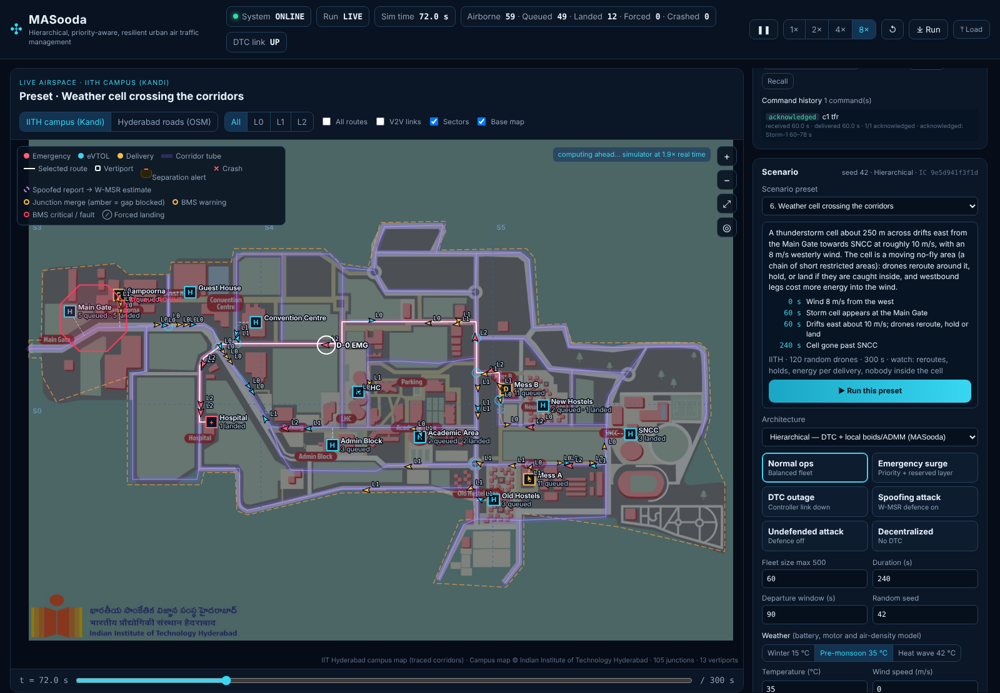

<div align="center">

# MASooda Live Airspace

**Hierarchical, priority-aware and resilient traffic management for urban drone fleets — live in your browser.**

[](https://masooda.onrender.com/)




</div>

## Overview

MASooda simulates hundreds of drones flying road-aligned corridors over the IIT Hyderabad campus and Hyderabad city streets.
Each drone resolves conflicts with its neighbours through ADMM optimisation. A central **Drone Traffic Controller (DTC)** allocates airspace layers and priorities, and a resilient consensus layer filters spoofed position reports.
The live demo streams the simulation to the browser, where you can watch every drone's safety, network and battery state and act as the air-traffic operator.

## Key features

- **Map-constrained flight:** corridor routes on the IITH campus and OpenStreetMap Hyderabad roads, layered airspace, vertiports, geofence.
- **Distributed deconfliction:** ADMM conflict resolution with a live convergence timer (iterations, solve time, p95, fallbacks).
- **Drone Traffic Controller:** priority-aware layer allocation per sector, a reserved emergency layer, and graceful degradation when the DTC link fails.
- **Resilience:** GPS-spoofing attacks, trusted-range checks and W-MSR fusion, with reported vs. estimated positions shown on the map.
- **Formal safety:** layer-aware STL robustness ρ(t), near-miss and crash detection, and a V2V network-theory panel.
- **Drone health:** battery (equivalent-circuit) and BMS model with per-cell voltages, pack and motor temperatures, and weather effects, plus a battery matrix of the whole fleet.
- **Operator console:** reroute, hold, return to base, ground stop, temporary flight restrictions drawn on the map, quarantine and battery swap, each checked against remaining energy.
- **10 scripted scenarios:** medical emergency, pop-up TFR, DTC outage, weather cell, heat wave, 60-minute operations and more, with side-by-side variant comparison.
- **Architecture comparison:** hierarchical, centralized, decentralized and undefended runs from identical initial conditions; runs export to JSON for replay.

## Tech stack

| Layer | Tools |
|---|---|
| Simulation | Python 3.10+, NumPy, PyYAML |
| Analysis & figures | Matplotlib, pytest |
| Live server | Python standard library (`http.server`): streaming JSON API |
| Front end | HTML, CSS, vanilla JavaScript, Canvas 2D (no frameworks) |
| Map data | IITH campus map (traced corridors), OpenStreetMap (ODbL) |
| Hosting | Render |

## Getting started

```bash
git clone https://github.com/rlv-iith/MASooda.git
cd MASooda
pip install numpy pyyaml matplotlib pytest      # or: uv sync

python -m web_sandbox.server                    # → http://127.0.0.1:8765
```

Pick a **scenario preset** and press **Run this preset**, or set the fleet size and launch your own run.

Headless runs and tests:

```bash
python main.py --architecture hierarchical --scenario mvp --agents 60 --duration 180 --out outputs/mvp
python -m pytest -q
```

## Project structure

```
web_sandbox/           Live demo: server, streaming API, browser UI
simulation/            Route engine, road network, drone health, DTC console, presets
conflict_resolution/   ADMM solver and conflict detection
local_behavior/        Boids rules, merging and formation metrics
resilience/            Attack injection, defence, W-MSR consensus
verification/          STL monitors and safety metrics
configs/               base_config.yaml: every model parameter and limit
data/                  Maps (IITH, Hyderabad) and scenario presets
docs/                  Design notes, health model, research gap, results
```

## Documentation

- [Live demo guide](docs/LIVE_DEMO.md) · [Scenario presets](docs/SCENARIO_PRESETS.md) · [Drone health model](docs/DRONE_HEALTH_MODEL.md)
- [Research gap: health-aware UTM](docs/RESEARCH_GAP_HEALTH_AWARE_UTM.md) · [Week 6 experiment results](outputs/week6/RESULTS.md)

## Team

Built at **IIT Hyderabad**: Mohammed Abdur Rehman · R Lalith Vishnu · Bhuvan · Tanmay Banjari · Sampadram · Dhadheechi

Repository: [github.com/rlv-iith/MASooda](https://github.com/rlv-iith/MASooda)

> Research simulation. Corridors are a planning backbone, not approved flight paths.
